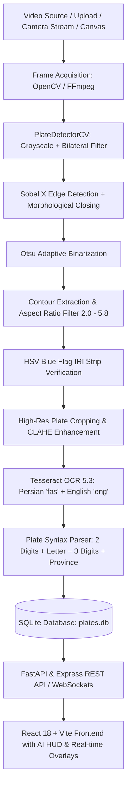

# Iranian ANPR System — Agent & Architecture Specification (`AGENTS.md`)

Welcome to the **Iranian Automated Number Plate Recognition (ANPR)** development & agent guidebook. This document serves as the authoritative blueprint for AI agents, automated development pipelines, and human engineers maintaining or extending this repository.

---

## 1. System Vision & Architecture

The system is a production-grade, end-to-end Automated License Plate Recognition platform specialized for **Iranian National License Plates** (including private passenger cars, public transport, taxis, government vehicles, and two-line motorcycles).

### High-Level Architectural Flow



---

## 2. Agent Roles & Responsibilities

When automated agents or sub-agents operate on this codebase, adhere to the following domain separation:

### 1. Vision & ANPR Agent (`backend/anpr_system.py`, `anpr_system.py`)
- **Primary Responsibility:** Pixel-level computer vision, image enhancements, contour detection, and character recognition.
- **Key Constraints:**
  - Standard Iranian plate aspect ratio is $4.56$ ($520\text{ mm} \times 114\text{ mm}$). Valid range for candidate contours is $2.0 \le \frac{w}{h} \le 5.8$.
  - Two-line motorcycle plates have an aspect ratio between $1.2$ and $2.2$.
  - Standard IRI blue strip is positioned at the leftmost $12\text{–}20\%$ of the plate rectangle (`HSV: H [90, 135], S [70, 255], V [50, 255]`).
  - Standard output (`stdout`) MUST remain clean JSON when called via CLI so that host processes can parse stdout without parsing corruption. All diagnostic logs MUST be routed to `sys.stderr`.

### 2. Stream & Video Ingestion Agent (`server.ts`, `backend/main.py`)
- **Primary Responsibility:** Handling multi-format video uploads (MP4, MKV, AVI, WebM), external live IP camera streams (RTSP, HLS `.m3u8`, HTTP video), and canvas frame snapshots.
- **Key Constraints:**
  - Static media files must be served with proper MIME types and `Accept-Ranges: bytes` support for seeking in HTML5 video elements.
  - Subprocess execution must maintain timeouts (4–8 seconds) to prevent frozen ffmpeg/python threads from stalling the Node or FastAPI event loops.

### 3. Database & Deduplication Agent (`LicensePlateDatabase`)
- **Primary Responsibility:** SQLite schema integrity, deduplication, log tracking, and search indexing.
- **Key Constraints:**
  - Duplicate detection is based on the normalized Persian plate text (`plate_full_fa`).
  - Upon detecting an existing plate, increment `detection_count`, update `last_seen`, and retain the highest confidence score and cleanest crop image.
  - Foreign keys in `detection_logs` must reference `detected_plates(id)`.

### 4. Frontend & HUD Agent (`frontend/src/App.tsx`, `frontend/src/components/`, `src/`)
- **Primary Responsibility:** Real-time user experience, Persian typography (Vazirmatn), responsive layout, and interactive AI targeting overlays.
- **Key Constraints:**
  - Overlay bounding boxes are normalized to percentage coordinates (`box_pct: { left, top, width, height }`) to ensure perfect responsiveness across any screen resolution.
  - Iranian license plates must be displayed using the realistic SVG/CSS `PersianPlate` component with blue IRI bar, Persian letter, and Iran province badge.

---

## 3. Technology Stack & Environment

| Layer | Technology | Version | Purpose |
| :--- | :--- | :--- | :--- |
| **Language** | Python | 3.10+ / 3.11 | Core Computer Vision, OCR, SQLite Backend |
| **CV Engine** | OpenCV (`cv2`) | 4.6.0+ | Frame capture, Bilateral filters, Sobel, Morphology |
| **Numerical** | NumPy | 1.24+ | Array manipulation, color masking, histogram math |
| **OCR Engine** | Tesseract OCR | 5.3+ (`fas` + `eng`) | Persian and numerical optical character recognition |
| **OCR Bridge** | PyTesseract | 0.3.10+ | Python-Tesseract binding |
| **Web Server** | FastAPI (Port 8002) & Express (Port 3000) | 0.92+ / 4.21+ | RESTful APIs, Swagger docs (/docs), static streaming |
| **Frontend** | React + Vite (Port 5002) | 19.0+ / 8.3+ | UI components, video canvas, terminal viewer |
| **Styling** | Tailwind CSS | 4.0+ | Modern glassmorphism & responsive RTL UI |
| **Database** | SQLite 3 | 3.40+ | Local ACID storage (`data/plates.db`) |

---

## 4. Verification & Testing Playbook

Before committing or deploying changes, agents must run the following validation steps:

### 1. Python ANPR Unit & Integration Tests
```bash
python3 test_anpr.py
```
**Expected Output:** All 4 tests must pass:
1. SQLite schema creation and required columns check.
2. Single plate insertion, Persian translation, and province code resolution.
3. Duplicate plate detection and `detection_count` increment verification.
4. Full end-to-end processing of surveillance video clip with $\ge 5$ verified vehicles.

### 2. Frontend Build & Typecheck
```bash
# Verify TypeScript syntax and imports
npx tsc --noEmit

# Verify Vite production build
npm run build
```

### 3. CLI Direct Detection Validation
```bash
# Test single live stream frame at 26.0s
python3 anpr_system.py --stream "/assets/aistudio/VID_20261029_183130_849_4af72e51.mp4" --sec 26.0 --db data/plates.db
```

---

## 5. Coding Standards & Conventions

1. **Persian String Normalization:**
   Always use `normalize_persian_letter()` and `to_persian_digits()` / `to_english_digits()` when persisting or querying plate numbers.
   - Arabic `ي` $\rightarrow$ Persian `ی`
   - Arabic `ك` $\rightarrow$ Persian `ک`
2. **Error Handling:**
   - Always wrap file and camera I/O in defensive `try/except` blocks.
   - If OpenCV fails to decode an exotic stream codec, gracefully fall back to the FFmpeg sub-pipe.
3. **No Mocks in Production:**
   Never use random number generators (`hashlib.md5`, `random.choice`) in place of real computer vision logic.
4. **Git Discipline:**
   - Commit messages must follow conventional commits: `feat(...)`, `fix(...)`, `docs(...)`, `refactor(...)`.
   - Maintain clean working trees without committing bulky raw video files ($>50\text{MB}$) or `__pycache__`.

---

## 6. Iranian License Plate Format Reference

Standard format follows:
$$\underbrace{\text{۲ رقم}}_{\text{Part 1}} \quad \underbrace{\text{حرف فارسی}}_{\text{Series Letter}} \quad \underbrace{\text{۳ رقم}}_{\text{Part 2}} \quad - \quad \underbrace{\text{ایران [۲ رقم]}}_{\text{Province Code}}$$

Example:
- `۱۴ ه ۲۵۹ - ایران ۲۰` $\rightarrow$ `Part 1: 14`, `Letter: ه`, `Part 2: 259`, `Province: 20 (اصفهان)`
- `۸۲ ه ۳۳۷ - ایران ۱۰` $\rightarrow$ `Part 1: 82`, `Letter: ه`, `Part 2: 337`, `Province: 10 (تهران پایتخت)`
- `۷۱ ص ۴۴۷ - ایران ۴۴` $\rightarrow$ `Part 1: 71`, `Letter: ص`, `Part 2: 447`, `Province: 44 (تهران شمال)`
- `۵۱ ل ۹۵۵ - ایران ۲۰` $\rightarrow$ `Part 1: 51`, `Letter: ل`, `Part 2: 955`, `Province: 20 (اصفهان)`
- `۸۷ ج ۷۶۸ - ایران ۵۵` $\rightarrow$ `Part 1: 87`, `Letter: ج`, `Part 2: 768`, `Province: 55 (گیلان رشت)`
- `۱۴۴ / ۱۵۶۴۹` $\rightarrow$ Motorcycle plate format (Line 1: 3 digits, Line 2: 5 digits).

---

*Authored for automated agents, contributors, and maintainers of the Iranian ANPR System.*
